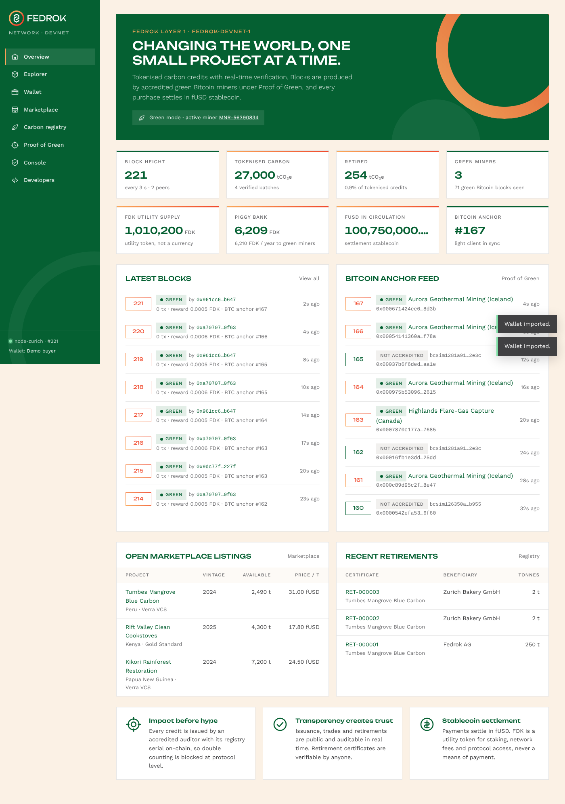
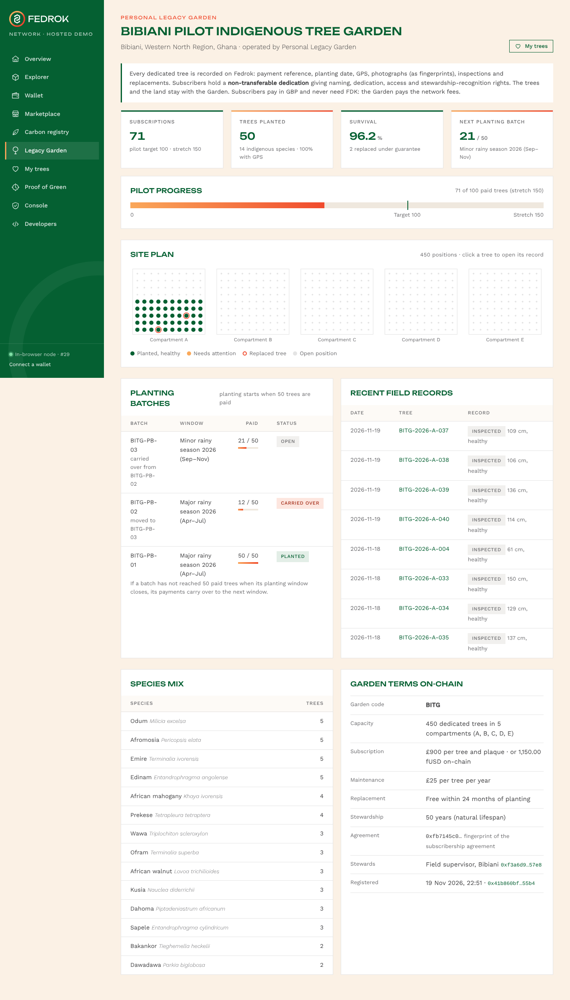

# Fedrok Network

A working Layer 1 blockchain platform for Fedrok AG: tokenised carbon credits, Proof of Green consensus anchored to Bitcoin, a stablecoin-settled marketplace, and a branded explorer, wallet and governance console.

> **Changing the world, one small project at a time.**



## Hosted demo

`npm run build:demo` builds `dist/fedrok-demo.html`: the full web app plus a complete network running inside the browser (simulated Bitcoin chain, a validating node with three block generators, faucet and demo data). It uses the same protocol code (`src/core`) and API layer (`src/node/api-core.js`) as a server node; only the transport differs. Each visitor gets their own network, saved in their browser.

## Quick start

Requires Node.js 20 or newer.

```bash
npm install
npm run devnet -- --reset   # Bitcoin simulator + 3 Fedrok nodes (Zurich, Geneva, Zug)
npm run demo                # in a second terminal: seeds miners, generators, credits, trades
```

Open **http://127.0.0.1:8545** for the explorer and wallet. The other nodes serve the same UI on ports 8546 and 8547.

To try the wallet, either create a new wallet and press **Get devnet FDK and fUSD**, or import one of the demo keys from `devnet/keys/`:

| Key file | Role |
|---|---|
| `demo-buyer.key` | Corporate buyer holding fUSD |
| `auditor.key` | Accredited auditor: issues credits, accredits miners, back-mints FDK |
| `governance.key` | Fedrok AG governance: auditors, parameters, fallback validator |
| `stable-issuer.key` | Stablecoin issuer: mints fUSD against reserve attestations |
| `developer-*.key` | Project developers who listed credits |
| `miner-*.key` | Owners of the accredited green miners |

Run the protocol tests with `npm test`.

## Token model: FDK is a utility token, payments use a stablecoin

| | FDK | fUSD (settlement stablecoin) |
|---|---|---|
| Purpose | Utility: network fees, block generator staking, Proof of Green mining rewards, protocol access, burn to record carbon consumption | All payments between parties, including every marketplace purchase |
| Created by | Piggy Bank pre-fill when an auditor accredits a green miner (23 FDK per S9-equivalent unit per year), or auditor back-minting 1 FDK per tonne of verified credits locked in the backing vault | The designated stablecoin issuer, against a reserve attestation reference |
| Priced in | Never priced or used as payment on the platform | 6 decimals, 1:1 USD (devnet stand-in) |

`fUSD` is a placeholder for whichever regulated stablecoin Fedrok selects (USD or CHF). Its symbol and name are set in `devnet/genesis.json`, and the issuer address can be changed by governance (`gov_set_stable_issuer`).

## Personal Legacy Garden (prototype)

A memorial tree registry on Fedrok for the Bibiani Pilot Indigenous Tree Garden. Families, friends and institutions subscribe to dedicate an indigenous tree; every subscription, planting, GPS position, inspection and replacement is recorded on-chain.



| On-chain (`src/core/garden.js`) | Off-chain (Garden records, fingerprint on-chain) |
|---|---|
| Garden, compartments, capacity, prices, accredited stewards | Customer contact details and consents |
| Dedications: holder account, package, plaque text (only with consent to display), GBP payment reference | Names without display consent (salted hash only) |
| Planting batches of 50: released when full, carried over to the next window if not | Photographs (SHA-256 fingerprint only) |
| Trees: Tree ID (`BITG-2026-A-001`), species, GPS, seed source, inspections, deaths and replacements | Signed subscribership agreement (hash only) |
| Annual maintenance renewals | |

Rules enforced by the protocol:

- Only governance registers a Garden; only its operator accredits stewards; only the operator or a steward records subscriptions and field data.
- Subscribers never need FDK. The Garden signs every record and pays the FDK network fee. Payments are GBP (card or bank transfer, reference recorded once) or, optionally, the settlement stablecoin paid straight to the operator. FDK is never a payment.
- A tree can only be planted for a dedication in a **released** batch (50 paid). Closing a planting window with an unfilled batch moves its paid subscriptions to the next window.
- A Tree ID is unique, must match the garden code, a real compartment and the planting year. A tree that dies keeps its Tree ID and dedication; the replacement gets a new date and GPS. Replacement within 24 months is recorded as free; after that it must say how it is covered.
- Dedications cannot be transferred or traded.

Transactions: `garden_register`, `garden_steward`, `dedication_create`, `planting_window_close`, `tree_plant`, `tree_monitor`, `tree_replace`, `maintenance_renew`. API: `/api/gardens`, `/api/garden/:id`, `/api/tree/:id`, `/api/dedication/:id`, `/api/dedications?holder=`. Web pages: **Legacy Garden** (site plan, batches, field records), tree page with a scannable QR tag, subscribership certificate, **My trees** member dashboard and a steward console. `npm run demo` (and the hosted demo) seed the Bibiani pilot with fictional sample data: 71 subscriptions, 50 trees planted, two replaced under guarantee, one batch carried over.

## How Proof of Green works here

1. An **auditor** accredits a Bitcoin miner after a green audit. The miner proves it controls its Bitcoin address by signing a link message with the Bitcoin key. Accreditation pre-fills the **Piggy Bank** with `units × 23 FDK × auditDays/365`.
2. Staked **block generators** link to miners (public miners accept anyone; private miners approve generators first).
3. Every Fedrok node runs a **Bitcoin light client**. Each Fedrok block carries the new Bitcoin headers, which every validator checks for linkage and proof of work.
4. When an accredited miner wins a Bitcoin block, that miner becomes active and **its generators take turns** producing Fedrok blocks in fixed time slots (round robin). A generator that misses its slot is replaced by the next one automatically.
5. Each block pays a Piggy Bank emission of `sum(active yearly rewards) × elapsed time / year`, split between the miner owner and the generator by the miner's generator share. Fees go to the generator.
6. If no green Bitcoin block arrives within `greenWindow` Bitcoin blocks, the governance-assigned **fallback validator** produces blocks until green mining resumes.
7. Revoking a miner burns the unserved part of its yearly reward from the Piggy Bank. Accreditation expires at the end of the audit period.

## What's included

- **Node** (`src/node.js`): chain storage, mempool with pre-validation, Proof of Green block production, longest-chain fork choice with reorgs, WebSocket P2P gossip and sync, REST API, JSON-RPC 2.0 and a live WebSocket feed.
- **Core protocol** (`src/core/`): secp256k1 keys with Ethereum-style addresses, signed transactions, 24 transaction types, deterministic state transitions, state roots and transaction Merkle roots. The same modules run in the browser for local signing.
- **Carbon registry**: auditor-issued credit batches with registry, methodology, vintage and serial range. A serial can only be tokenised once (double counting blocked on-chain). Transfers, retirements with printable certificates, and a backing vault.
- **Marketplace**: escrowed listings priced per tonne in fUSD, atomic purchase (stablecoin to seller, credits to buyer in one transaction), configurable platform fee paid in fUSD.
- **Web app** (`web/`): overview, explorer and search, wallet, marketplace, registry, retirement certificates, Proof of Green monitor, governance and auditor console, developer docs. Built to the Fedrok brand guidelines (Dark green, Sandy→Cinnabar gradient, Eerie black, Cream; Unbounded and Work Sans; 90° corners; outline icons; UK English).
- **Bitcoin simulator** (`src/btc/simulator.js`): a proof-of-work header chain with green and non-green miners for local networks.
- **Personal Legacy Garden** (`src/core/garden.js`, `src/core/garden-scenario.js`): memorial tree registry, see above.
- **Tests** (`test/`): Legacy Garden registry rules, settlement, stablecoin-only payments, double-counting protection, auditor permissions, Proof of Green mode switching and rewards, forged Bitcoin proofs, tampered blocks and governance checks.

## API

```bash
curl -s http://127.0.0.1:8545/api/status
curl -s http://127.0.0.1:8545/rpc -H 'content-type: application/json' \
  -d '{"jsonrpc":"2.0","id":1,"method":"carbon_getListings"}'
```

The full endpoint and method list is on the **Developers** page of the web app.

## Running a node by hand

```bash
node src/node.js --name=my-node --genesis=devnet/genesis.json --data=data/my-node \
  --api-port=8550 --p2p-port=30310 --peers=ws://127.0.0.1:30303 \
  --btc=http://127.0.0.1:18443 [--key=path/to/generator.key]
```

A node without `--key` is a full validating node that does not produce blocks.

## Decisions where the specification conflicted

The whitepaper (V1, 1 Aug 2025) contradicts the instruction that FDK is a utility token. This build follows the instruction:

- p.22 calls FDK "the native currency of the Fedrok blockchain" and gives "a final price target of approximately $0.2". Not implemented: FDK has no price, and nothing on the platform is priced in FDK.
- p.25 says developers use FDK "for transaction fees, payments, and on-chain interactions" and compares FDK to USDT (p.25–26). Here FDK covers fees and protocol access only; payments use the stablecoin.
- The summary (p.29) and brand glossary say "Fedrok Coins (FDKs)" / "FDK Coin". The UI says "FDK utility token".
- The spec also disagrees with itself on units: "1 FDK represents one tonne" vs "$0.2 ... offsetting one kilogram of CO₂", and p.24 defines a carbon credit as the right to emit one kilogram (the market standard is one tonne). This build uses 1 credit unit = 1 tCO₂e and 1 back-minted FDK = 1 tonne locked.
- The spec's block reward divides "the Piggy Bank balance" by seconds per year, which would shrink rewards every block. This build uses the sum of active miners' yearly reward amounts, which equals the pre-fill at accreditation and keeps emission steady.

## Devnet versus production

This is a complete, running network suitable for demos, pilots and as the base for the production chain. Before a public mainnet, plan for:

- **EVM execution.** The spec calls for an EVM chain. The protocol logic here is native (faster to audit and demo). Production should port it to EVM smart contracts on a client such as Geth or Reth with Proof of Green as the consensus engine. Keys and addresses are already Ethereum-compatible.
- **Real Bitcoin light client** (SPV over real headers and coinbase outputs) in place of the simulator.
- **Hardened consensus**: generator slashing for equivocation, finality checkpoints, and a minimum anchor-freshness rule across peers.
- **Key management**: governance and auditor keys in HSMs or multisig, and a production wallet (hardware or custodial) instead of browser-stored keys.
- **Regulated stablecoin** integration, FINMA review, security audit and penetration test, persistent indexed storage (LevelDB or Postgres) and monitoring.
- **Brand assets**: replace the PNG logo extracted from the guidelines PDF with the official SVG files.

## Project layout

```
src/core/       protocol: crypto, units, transactions, state, consensus, SDK client
src/node/       chain storage, P2P, Bitcoin light client, API server
src/btc/        Bitcoin network simulator
src/node.js     node entrypoint
scripts/        devnet launcher and end-to-end demo
web/            explorer, wallet, marketplace and console (vanilla JS)
test/           protocol tests
docs/           screenshots
```
